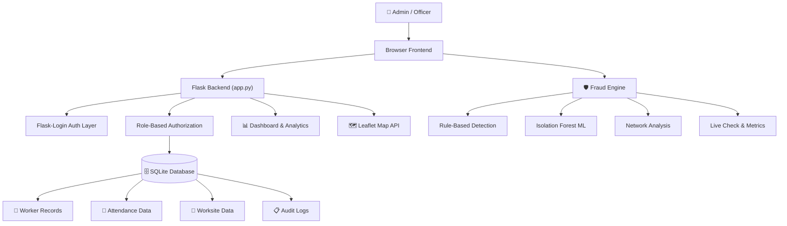

<div align="center">


<svg xmlns="http://www.w3.org/2000/svg" width="1200" height="260" viewBox="0 0 1200 260">
  <defs>
    <linearGradient id="bg" x1="0" y1="0" x2="1" y2="1">
      <stop offset="0%" stop-color="#0b1020"/>
      <stop offset="55%" stop-color="#16213e"/>
      <stop offset="100%" stop-color="#0f3460"/>
    </linearGradient>
    <linearGradient id="accent" x1="0" y1="0" x2="1" y2="0">
      <stop offset="0%" stop-color="#00d4ff"/>
      <stop offset="100%" stop-color="#e94560"/>
    </linearGradient>
  </defs>

  <rect width="1200" height="260" rx="18" fill="url(#bg)"/>
  <circle cx="1040" cy="30" r="180" fill="#00d4ff" opacity=".06"/>
  <circle cx="1100" cy="220" r="130" fill="#e94560" opacity=".08"/>

  <path d="M0 220 Q300 170 600 225 T1200 190" fill="none" stroke="#00d4ff" opacity=".18" stroke-width="2"/>

  <text x="600" y="112" text-anchor="middle"
        font-family="Arial, sans-serif" font-size="64"
        font-weight="bold" fill="#00d4ff">GHOSTGUARD AI</text>

  <rect x="400" y="137" width="400" height="3" rx="2" fill="url(#accent)"/>

  <text x="600" y="178" text-anchor="middle"
        font-family="Arial, sans-serif" font-size="21"
        fill="#e2e8f0">INTELLIGENT FRAUD DETECTION</text>

  <text x="600" y="207" text-anchor="middle"
        font-family="Arial, sans-serif" font-size="17"
        fill="#94a3b8">AI-Powered Workforce Monitoring Platform</text>

  <text x="600" y="240" text-anchor="middle"
        font-family="Arial, sans-serif" font-size="12"
        letter-spacing="4" fill="#00d4ff">SECURE • SMART • REAL-TIME</text>
</svg>


<br/>

[](https://ghostguard-ai.onrender.com)
&nbsp;
[](https://github.com/ohhharyann/GhostGuard-AI/stargazers)
&nbsp;
[](https://python.org)
&nbsp;
[](https://flask.palletsprojects.com)

<br/>

> **Detect Fraud. Analyze Anomalies. Monitor Workforce Integrity.**
>
> *A full-stack platform combining rule-based fraud detection, ML anomaly detection,*  
> *interactive geospatial monitoring, and role-based access control — in one dashboard.*

<br/>

```
██████╗ ██╗  ██╗ ██████╗ ███████╗████████╗ ██████╗ ██╗   ██╗ █████╗ ██████╗ ██████╗ 
██╔════╝ ██║  ██║██╔═══██╗██╔════╝╚══██╔══╝██╔════╝ ██║   ██║██╔══██╗██╔══██╗██╔══██╗
██║  ███╗███████║██║   ██║███████╗   ██║   ██║  ███╗██║   ██║███████║██████╔╝██║  ██║
██║   ██║██╔══██║██║   ██║╚════██║   ██║   ██║   ██║██║   ██║██╔══██║██╔══██╗██║  ██║
╚██████╔╝██║  ██║╚██████╔╝███████║   ██║   ╚██████╔╝╚██████╔╝██║  ██║██║  ██║██████╔╝
 ╚═════╝ ╚═╝  ╚═╝ ╚═════╝ ╚══════╝   ╚═╝    ╚═════╝  ╚═════╝ ╚═╝  ╚═╝╚═╝  ╚═╝╚═════╝ 
```

</div>

---

## 🎬 See It In Action

<div align="center">


</div>

---

## ⚡ Quick Access

<div align="center">

| 🌐 Live App | 📂 Source Code | 👨‍💻 Developer |
|:-----------:|:--------------:|:-------------:|
| [ghostguard-ai.onrender.com](https://ghostguard-ai.onrender.com) | [GitHub Repo](https://github.com/ohhharyann/GhostGuard-AI) | [Aryan Raj](https://github.com/ohhharyann) |

**Demo Credentials**

| Field | Value |
|-------|-------|
| 👤 Username | `admin` |
| 🔑 Password | Aryan@123 |

> 💡 Hosted on Render's free tier — first load may take a few seconds if the service is cold.

</div>

---

## 🧠 What Is GhostGuard AI?

GhostGuard AI is a **production-ready fraud detection and workforce monitoring platform** designed to surface suspicious activity, track workforce patterns, and give administrators a centralized command center.

It combines:
- 🧮 **Rule-based & ML fraud detection** (Isolation Forest)
- 🗺️ **Interactive geospatial visualization** (Leaflet.js)
- 👥 **Granular role-based access control**
- 📋 **Full administrative audit logging**
- ❄️ **Worker freeze/unfreeze workflows** with mandatory justification

All in a single cohesive Flask dashboard backed by SQLite.

---

## ✨ Feature Highlights

<table>
<tr>
<td width="50%">

### 📊 Intelligent Dashboard
- Real-time KPI cards & workforce stats
- Visual analytics & trend charts
- Recent fraud alert feed
- Worksite risk summaries
- Highest-risk worker identification
- Embedded interactive map preview

</td>
<td width="50%">

### 👥 Worker Management
- Add, edit, view, and manage records
- Advanced search, sort & filter
- Paginated list + CSV export
- Detailed worker profiles
- Tabs: Attendance · Payments · Biometric · Fraud History

</td>
</tr>
<tr>
<td width="50%">

### 🛡️ Fraud Detection Engine
- **Rule-based** pattern detection
- **Isolation Forest** anomaly scoring
- Network / relationship analysis
- Suspicious activity alerts
- Live Check — test a worker in real time
- Evaluation metrics dashboard

</td>
<td width="50%">

### 🗺️ Geospatial Monitoring
- Leaflet-powered interactive map
- Street · Satellite · Terrain layers
- Worksite markers & geofence circles
- Flagged attendance heat points
- Worksite filtering & map legends

</td>
</tr>
<tr>
<td width="50%">

### ❄️ Worker Freeze Management
- One-click freeze / unfreeze
- Mandatory reason required every time
- Full freeze/unfreeze action history
- Audit trail preserved automatically
- Account-status control independent of wages

</td>
<td width="50%">

### 🔐 Security & Auth
- Flask-Login session management
- Bcrypt password hashing
- Mandatory first-login password change
- CSRF-protected forms throughout
- Server-side role enforcement on every route

</td>
</tr>
</table>

---

## 🏗️ System Architecture



> **Architecture note:** The database backend and browser fraud engine currently operate as complementary components. Database risk scoring uses the Python rule engine; Isolation Forest, evaluation metrics, and Live Check use the browser engine's generated dataset.

---

## 🔐 Role-Based Access Control

<div align="center">

| Role | Workers | Freeze/Unfreeze | Export | Delete | Audit Logs | Reset Data |
|------|:-------:|:---------------:|:------:|:------:|:----------:|:----------:|
| 🔴 **Super Admin** | ✅ Full | ✅ | ✅ | ✅ | ✅ | ✅ |
| 🟠 **District Admin** | ✅ Add/Edit | ✅ | ✅ | ❌ | ❌ | ❌ |
| 🟡 **Field Officer** | ✅ Add/Edit | ❌ | ❌ | ❌ | ❌ | ❌ |
| 🟢 **Auditor** | 👁️ Read-only | ❌ | ✅ | ❌ | ❌ | ❌ |

**All permissions are enforced server-side — no client-side bypass possible.**

</div>

---

## 🛠️ Tech Stack

<div align="center">

| Layer | Technology |
|-------|-----------|
| **Backend** | Python 3.10+, Flask |
| **Database** | SQLite (auto-initialized) |
| **Auth** | Flask-Login, Bcrypt |
| **Security** | CSRF Protection, Hashed Passwords |
| **Frontend** | HTML5, CSS3, Vanilla JS |
| **Mapping** | Leaflet.js |
| **Fraud ML** | Isolation Forest, Rule Engine |
| **Deployment** | Render (Free Tier) |
| **Version Control** | Git + GitHub |

</div>

---

## 📁 Project Structure

```
GhostGuard-AI/
│
├── 📄 app.py                   ← Flask application entry point
├── 📄 requirements.txt         ← Python dependencies
├── 📄 .env.example             ← Environment variable template
│
├── 📂 templates/               ← Jinja2 HTML templates
│   ├── base.html
│   ├── dashboard.html
│   ├── workers.html
│   └── ...
│
├── 📂 static/                  ← CSS, JS, assets
│   ├── style.css
│   ├── app.js
│   └── ...
│
├── 📂 screenshots/             ← Demo images & GIF
│   ├── dashboard.png
│   ├── workers.png
│   ├── map.png
│   ├── fraud-engine.png
│   └── demo.gif
│
└── 🗄️ ghostguard.db           ← Auto-generated on first run
```

---

## 🚀 Run Locally

### Prerequisites
- Python **3.10+**
- Git

```bash
# 1. Clone the repository
git clone https://github.com/ohhharyann/GhostGuard-AI.git
cd GhostGuard-AI

# 2. Create & activate virtual environment
python -m venv venv
venv\Scripts\activate          # Windows
# source venv/bin/activate     # macOS / Linux

# 3. Install dependencies
pip install -r requirements.txt

# 4. (Optional) Set a custom secret key
set SECRET_KEY=your-long-random-string    # Windows CMD
# export SECRET_KEY=your-long-random-string  # macOS / Linux

# 5. Launch the app
python app.py
```

Open **http://127.0.0.1:5000** in your browser.

> The SQLite database and all synthetic demo records are initialized automatically on the **first run**. Subsequent restarts preserve existing data.

---

## 📊 Current Status

| Feature | Status |
|---------|--------|
| Flask Authentication | ✅ Implemented |
| Worker Management | ✅ Implemented |
| Dashboard Analytics | ✅ Implemented |
| Interactive Maps | ✅ Implemented |
| Freeze / Unfreeze Management | ✅ Implemented |
| Audit Logging | ✅ Implemented |
| Browser Fraud Engine | ✅ Implemented |
| SQLite Rule-Based Risk Scoring | ✅ Implemented |
| Database-Integrated Isolation Forest | 🔲 Planned |
| Standalone Attendance Module | 🔲 Planned |
| Payments & Payroll Module | 🔲 Planned |
| Fraud Investigation Workflows | 🔲 Planned |
| Real-Time Notifications | 🔲 Planned |
| Advanced Network Visualization | 🔲 Planned |

---

## 🛣️ Roadmap

- [ ] Integrate Isolation Forest directly with database records
- [ ] Dedicated attendance management module
- [ ] Payments & payroll management
- [ ] Fraud investigation workflows
- [ ] Real-time notification system
- [ ] Advanced network relationship visualization
- [ ] Comprehensive PDF/Excel reporting
- [ ] Automated testing & CI/CD pipeline
- [ ] Migrate to production-grade PostgreSQL

---

## 🔒 Security Notes

GhostGuard AI implements:

| Control | Implementation |
|---------|----------------|
| Password Storage | Bcrypt hashing |
| Session Security | Flask-Login + server-side sessions |
| CSRF Protection | WTForms CSRF tokens on all forms |
| Authorization | Backend-enforced role checks |
| Audit Trail | Immutable admin action log |
| Account Actions | Mandatory reasons for freeze/unfreeze |

> ⚠️ This is a demonstration project. Before production use: configure persistent database storage, secure all secrets via environment variables, enforce HTTPS, and conduct a full security review.

---

## 👨‍💻 Developer

<div align="center">

**Aryan Raj**  
B.Tech — Computer Science & Engineering (Cloud Computing)

[](https://github.com/ohhharyann)
&nbsp;
[](https://www.linkedin.com/in/aryan-raj-link09/)

</div>

---

## ⭐ Support

If GhostGuard AI is useful or interesting to you, please consider giving it a **⭐ star** — it really helps!

Feedback, issues, and pull requests are all welcome.

---

<div align="center">


**GhostGuard AI** — Building smarter, more transparent workforce monitoring.

*Made with ❤️ by [Aryan Raj](https://github.com/ohhharyann)*

</div>
